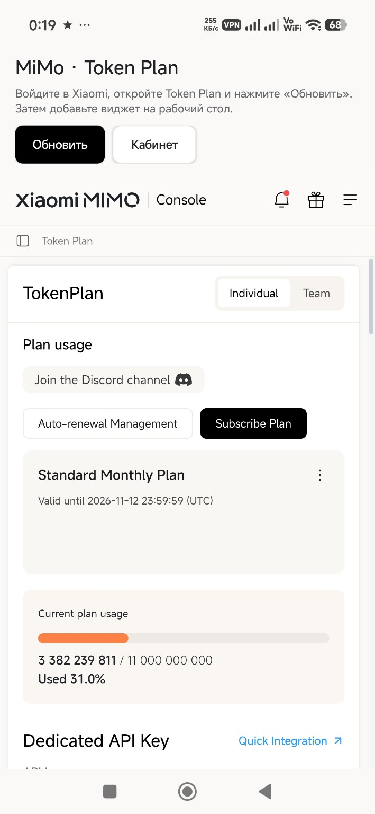
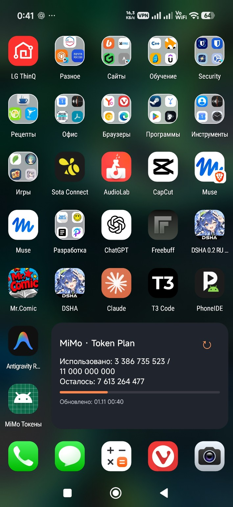

# MiMo Токены — виджет Xiaomi MiMo Token Plan

Android-приложение и виджет для просмотра расхода и остатка лимита Xiaomi MiMo Token Plan прямо на рабочем столе.

## Возможности

- Показывает использованный и доступный лимит, остаток, шкалу расхода и время последнего обновления.
- Позволяет обновить данные кнопкой **↻** в правом верхнем углу виджета.
- Периодически обновляет данные в фоне. Android и ограничения энергосбережения могут задерживать обновление.
- Открывает кабинет MiMo внутри приложения; нажатие на основную область виджета открывает приложение.
- Позволяет изменять ширину и высоту виджета, если это поддерживает лаунчер.

## Скриншоты

| Личный кабинет | Виджет на рабочем столе |
|:---:|:---:|
|  |  |

## Установка

1. Скачайте [MiMo-Token-Widget-1.2.apk](releases/MiMo-Token-Widget-1.2.apk).
2. Откройте скачанный файл и подтвердите установку. При необходимости разрешите установку приложений из этого источника в настройках Android.
3. Для работы требуется Android 8.0 или новее и доступ в интернет.

Проверка безопасности выполняется средствами защиты на вашем устройстве, например Google Play Защитой и встроенной защитой Xiaomi, если они включены.

## Вход в кабинет

1. Откройте приложение **«MiMo Токены»** и войдите в свою учётную запись Xiaomi на странице личного кабинета.
2. Перейдите в **Token Plan** и нажмите **«Обновить»** в приложении.
3. Если сессия истекла и данные перестали обновляться, снова откройте приложение и войдите в кабинет.

Вход происходит на странице Xiaomi внутри приложения. Сессия сохраняется на устройстве; для получения показателей приложение передаёт сессионные cookie непосредственно серверу Xiaomi. Полученные значения сохраняются локально. Отдельный сервер разработчика приложение не использует.

## Добавление виджета

1. На рабочем столе нажмите и удерживайте пустое место.
2. Выберите **«Виджеты»** → **«MiMo Токены»** и разместите виджет.
3. Чтобы изменить размер, удерживайте виджет и потяните за его границы — если лаунчер поддерживает изменение размеров.
4. Для ручного обновления нажмите **↻** в правом верхнем углу виджета. Если фоновые обновления задерживаются, проверьте настройки энергосбережения приложения и возможности своего лаунчера.

## Сборка из исходников

Откройте проект в Android Studio с установленными Android SDK Platform 35 и JDK 17; при первом запуске Gradle загрузит необходимые зависимости. Для сборки используйте задачу `assembleDebug`. Исходники, ресурсы и манифест находятся в `app/src/main`.

Готовый APK в папке `releases` подписан ключом автора. Самостоятельно собранный debug APK подписывается другим ключом и не установится поверх официального APK: для его установки необходимо удалить предыдущую версию приложения, потеряв локальные данные и сессию.

## Особенности

Приложение использует запросы личного кабинета Xiaomi, которые могут измениться без предупреждения. Проект не является официальным приложением Xiaomi и не связан с Xiaomi.
